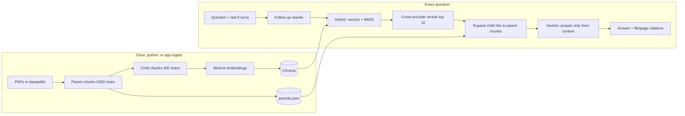

# 🎓 College Student Helpdesk (RAG)

Ask questions about **MKSSS's Cummins College of Engineering for Women** using three public PDFs: the academic calendar, college brochure, and placement statistics. Answers are generated only from those documents and include the PDF file and page. If the documents do not contain the answer, the app says:

> I couldn't find this in the college documents I have.

**Stack:** Python 3.12 · LangChain · ChromaDB · MiniLM embeddings · BM25 · cross-encoder reranking · Gemini · FastAPI · Streamlit · Docker

> Unofficial student project, not affiliated with the college. It only uses public documents. Check the official source before relying on any important information.


## Architecture



- **Ingestion:** `app/ingest.py` loads every PDF recursively, keeps page metadata, stores searchable 400-character child chunks in Chroma, and saves 2000-character parents in `chroma_db/parents.json`.
- **Retrieval:** `app/retrieval.py` supports `dense`, `bm25`, `hybrid`, and `rerank`. The default is hybrid retrieval followed by a cross-encoder (`cross-encoder/ms-marco-MiniLM-L-6-v2`) and parent expansion.
- **Generation:** `app/rag.py` rewrites follow-up questions, formats the retrieved parents with citations, and uses a strict context-only Gemini prompt.
- **Serving:** FastAPI provides `/ask`, `/ask/stream`, and `/health`. Streamlit calls the API when `API_URL` is set; otherwise it runs `rag.answer()` in-process, which is the Community Cloud deployment path.


## Measured results

The original 12-question experiment is kept for comparison:

| Experiment | Result |
|---|---|
| Rerank, parent-child, k=3 | Hit@k 100%, MRR 1.00, 12/12 answers |
| Hybrid, parent-child, k=4 | MRR 0.95, 12/12 answers |
| Hybrid, flat 800-character chunks, k=4 | MRR 0.93, 12/12 answers |
| Flat 400-character chunks | 11/12 answers |

The expanded hand-written set has 25 questions: 20 answerable and 5 expected refusals. Retrieval-only checks at k=3 were:

| Mode | Answerable hits | Hit@3 | MRR |
|---|---:|---:|---:|
| Dense | 18/20 | 90% | 0.84 |
| BM25 | 20/20 | 100% | 0.95 |
| Hybrid | 19/20 | 95% | 0.93 |
| **Rerank (default)** | **20/20** | **100%** | **1.00** |

The final full rerank generation run attempted all 25 questions and produced **25/25 correct answers**, including the five expected refusals and three follow-up questions. An earlier run had 8 transient Gemini provider errors/timeouts; the final run completed without them, so this remains a small-set result rather than a reliability guarantee.

Ragas was run on 10 answerable questions with references, Gemini as the evaluator LLM, and local MiniLM embeddings. The per-question output is in `eval_results.json`.

| Mode | k | Hit@k | MRR | Faithfulness | Answer relevancy | Context recall |
|---|---:|---:|---:|---:|---:|---:|
| Rerank | 3 | 100% | 1.00 | 1.000 | 0.649 | 1.000 |

Ragas is a small LLM-judge sample: several answer-relevancy rows were unavailable because of provider errors, so the average is based on the available scores.

### Latency and memory

Measured in one warm local process for the same Deutsche Bank question:

| Retrieval path | Median retrieval time |
|---|---:|
| Hybrid | 16.9 ms |
| Rerank | 164.7 ms |
| Rerank overhead | about 148 ms |

The first rerank call also loads the cross-encoder and took about 8 seconds in that process. A cold rerank retrieval process reached **535,314,432 bytes (about 510 MiB) peak resident memory**. This is close to a 512 MiB limit; an ONNX/fastembed embedding fallback is a future deployment option if the Community Cloud instance cannot keep the current MiniLM + PyTorch stack alive.

## Limitations and decisions

- The evaluation set is small and hand-written. Its scores do not prove general accuracy.
- Some wording still overlaps the documents, which favours keyword search.
- Tables are flattened to text, so aggregation questions such as totals, averages, or comparisons are weaker than direct lookups.
- Hit@k is now measured against larger parent chunks, not the old flat chunks.
- Ragas uses a small sample and an LLM judge, so its scores have sampling and provider noise.
- Gemini's free tier can return temporary 503/high-demand errors or timeouts.
- A scraper was tried and dropped because the college website blocked automated requests.
- A SQL engine and intent router were intentionally skipped as overkill for this learning project.

## Run locally

```bash
git clone <this-repo> && cd <this-repo>
python3.12 -m venv venv
source venv/bin/activate
pip install -r requirements.txt
printf 'GOOGLE_API_KEY=your_key\n' > .env
python -m app.ingest
```

API mode:

```bash
uvicorn app.api:app --reload       # http://localhost:8000/docs
API_URL=http://localhost:8000 streamlit run ui.py
```

In-process mode (the Streamlit Community Cloud path):

```bash
streamlit run ui.py
```

If `chroma_db/` is missing, `ui.py` builds it once using `st.cache_resource`. Do not commit `.env` or `chroma_db/`.

Evaluation:

```bash
python eval.py --no-llm --mode dense --k 3
python eval.py --no-llm --mode bm25 --k 3
python eval.py --no-llm --mode hybrid --k 3
python eval.py --no-llm --mode rerank --k 3
python eval.py --mode rerank --k 3
python eval.py --ragas --mode rerank --k 3
```

`eval.py` prints a Markdown comparison row. The Ragas command writes `eval_results.json`.

Docker:

```bash
docker build -t college-helpdesk .
docker run --rm -p 8501:8501 -e GOOGLE_API_KEY=your_key college-helpdesk
```

The Docker image uses Python 3.12, CPU-only PyTorch, a non-root user, and downloads the embedding and reranker models while building the image.

## Project structure

```text
app/config.py       settings and environment overrides
app/ingest.py       PDFs -> parent/child chunks -> Chroma
app/retrieval.py    dense, BM25, hybrid RRF, reranking, parent expansion
app/rag.py          follow-up rewrite, prompt, Gemini, timings, streaming
app/api.py          FastAPI endpoints and validation/error handling
ui.py               Streamlit UI with API or in-process mode
data/pdfs/          the three public source PDFs
eval.py             retrieval/generation/Ragas evaluation
eval_results.json   latest Ragas per-question scores
questions.json      hand-written questions, evidence, references, history
Dockerfile          reproducible CPU image
entrypoint.sh       API background process + Streamlit foreground process
```

## Future work

- Add read-only text-to-SQL with row limits for reliable aggregation questions.
- Scrape additional college information only with the college's permission.
- Consider an ONNX/fastembed fallback if the current memory footprint is too high.
